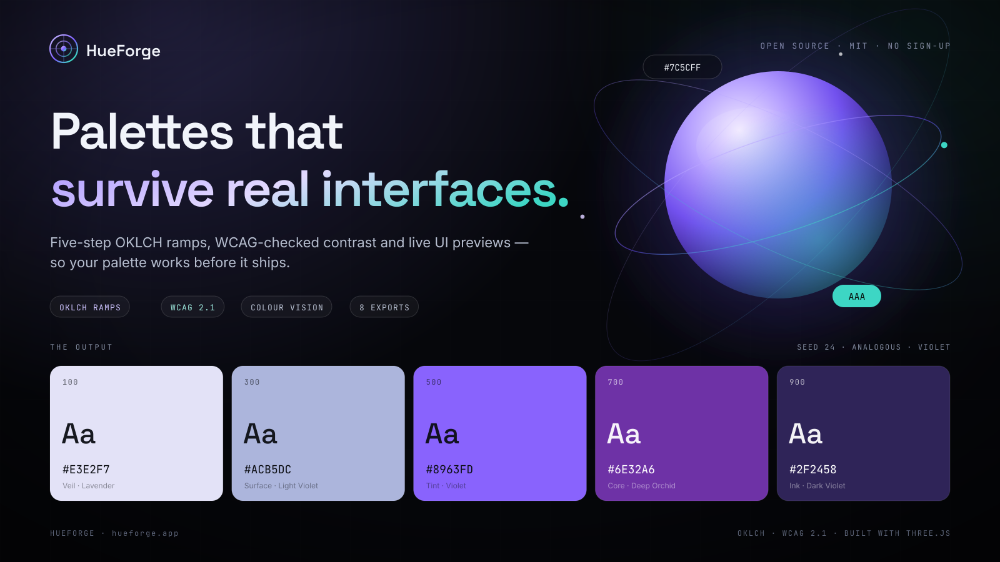
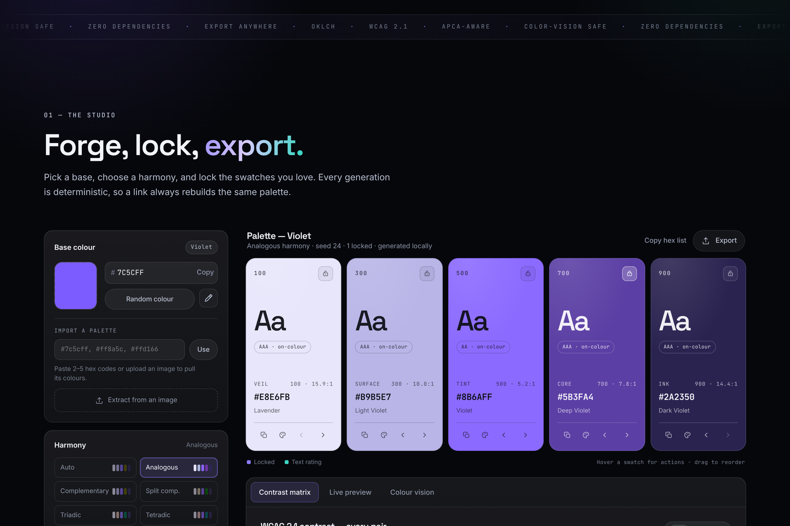
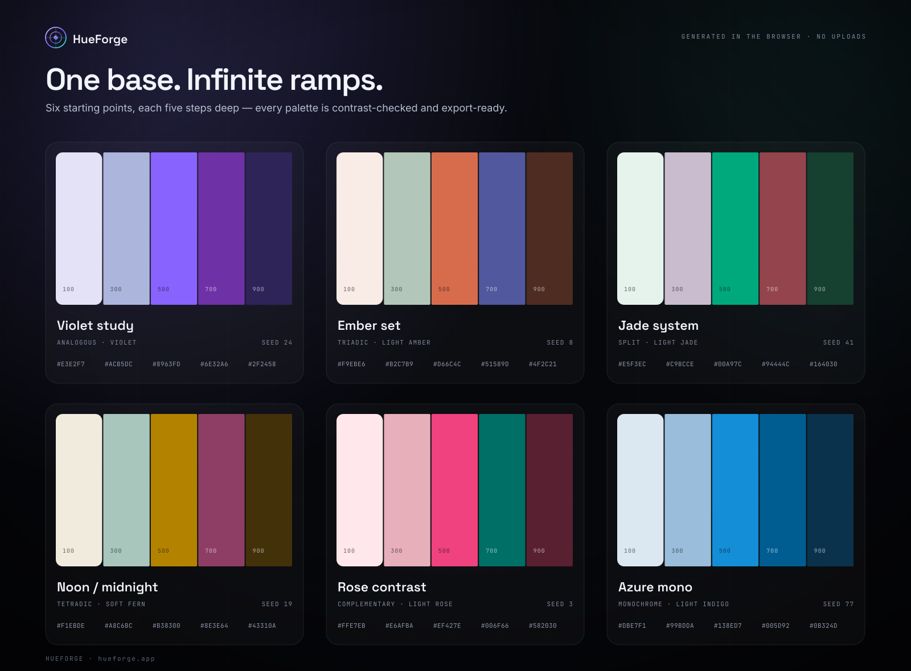
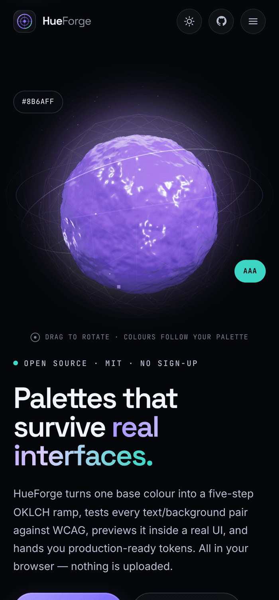
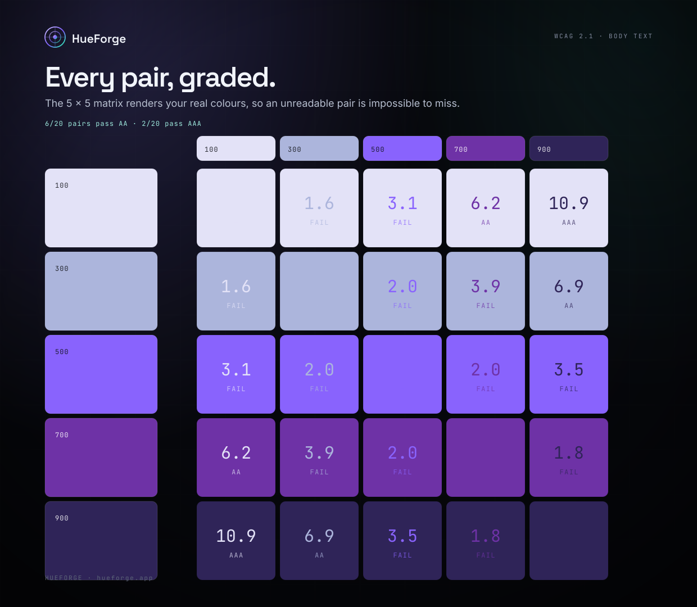
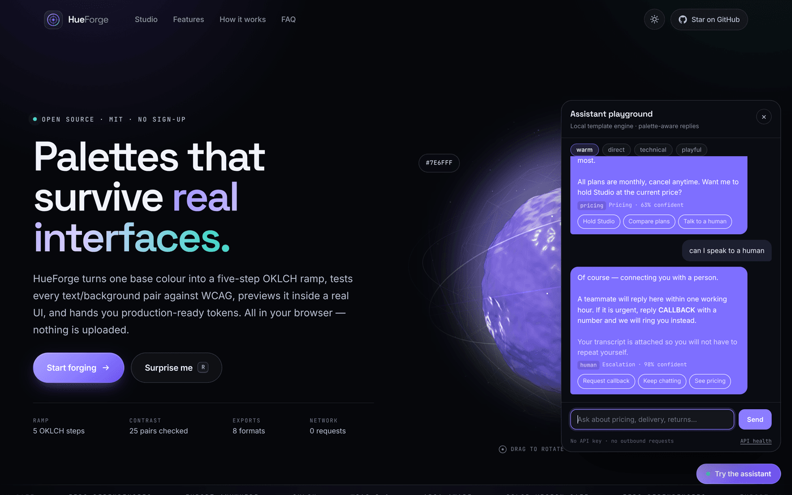

<div align="center">



# HueForge

**Turn one base colour into a five-step OKLCH ramp that is contrast-tested, previewable in real UI, and exportable in eight formats — instantly, locally, and for free.**

[](LICENSE)
[](package.json)
[](tests)
[](https://www.w3.org/WAI/WCAG22/quickref/)
[](.github/workflows/deploy-pages.yml)
[](CONTRIBUTING.md)

[**Live demo**](https://saturogojo777.github.io/whatsapp-ai-bot/) · [Features](#-features) · [Quick start](#-quick-start) · [Deploy](#-deploy-in-90-seconds) · [Contributing](#-contributing) · [FAQ](#-faq)



</div>

---

## The problem

You pick a brand colour. You squint at a colour picker, drag a slider around, and end up with five hex codes that look *roughly* related. Then the real work starts:

- the second step is nearly invisible against the first;
- the accent looks fine on your retina display and unreadable on a colleague's monitor;
- the "dark mode" variant was invented by hand, twice;
- and every engineer who touches the design system pastes a slightly different hex because nobody can find the canonical tokens.

Colour pickers optimise for *choosing a colour*. Interfaces need a **ramp**: consistent lightness steps, text that stays legible on every step, and tokens that survive a handoff.

**HueForge does that one job end to end** — from a single base colour to exported, accessibility-checked design tokens — in a single page that runs entirely in your browser.

---

## ✨ Features

<table>
<tr>
<td width="50%" valign="top">

### 🎨 OKLCH, not guesswork
Five calibrated steps (`100 → 900`) with perceptual lightness, hue and chroma ramps. Gamut-mapped back to sRGB so nothing breaks on older browsers.

### 🔒 Lock and keep forging
Found two swatches you love? Lock them. Every subsequent generation keeps your picks and reshapes everything else — with full undo/redo.

### 🧪 Contrast on every pair
A 5 × 5 WCAG 2.1 matrix rendered in your real colours, graded AA / AAA / large-text. Because if the ratio is hard to read, the pair is hard to read.

</td>
<td width="50%" valign="top">

### 👁️ Colour-vision simulation
Protanopia, deuteranopia, tritanopia and achromatopsia previews, computed with Viénot–Brettel–Mollon matrices in linear light.

### 🖥️ Live, honest previews
A marketing card and a dense dashboard — both built from *only* your five swatches. No secret extra tints. If it looks wrong here, it looks wrong in production.

### 📦 Eight real exports
CSS, Tailwind v4, SCSS, JSON, W3C design tokens, SVG poster, Adobe `.ase` and a 1600 × 1000 PNG. Copy or download, no account.

</td>
</tr>
</table>

Plus: **palette-aware 3D** (a simplex-noise-displaced Three.js orb whose lighting, halo and environment map follow your colours), **image colour extraction** (k-means in OKLab), **eyedropper support**, **deterministic share links**, a **local palette library**, **dark & light themes**, **full keyboard control**, and **zero runtime dependencies**.

<div align="center">

<sub><i>Six starting points. Each generated from one base colour, in the browser, with no network requests.</i></sub>
</div>

<div align="center">

<sub><i>Same studio, one thumb. The layout collapses to a single column below 820 px.</i></sub>
</div>

---

## 🚀 Quick start

HueForge is plain HTML, CSS and ES modules. There is nothing to compile.

```bash
# 1. Clone
git clone https://github.com/saturogojo777/whatsapp-ai-bot.git
cd whatsapp-ai-bot

# 2. Serve (any static server works; this one has zero dependencies)
npm run dev
# → http://localhost:4173

PORT=8080 ROOT=dist npm run dev   # any port, any folder (e.g. a Pages build)
```

Prefer no Node at all?

```bash
python3 -m http.server 4173
# → http://localhost:4173
```

> **Opening `index.html` directly from disk works too** in most browsers, but ES modules and some clipboard APIs are restricted on `file://`. A local server is recommended.

### Optional: the playground

The repository also ships a tiny local server that demonstrates the assistant flow this repo's origin project is about — palette-aware WhatsApp-style replies, generated by a transparent template engine (no API key, no outbound requests):

```bash
npm run playground
# → http://localhost:4180  (look for "Try the assistant" in the corner)
```

```bash
curl -s localhost:4180/api/health
# {"ok":true,"engine":{"kind":"deterministic-template","intents":8,...}}
```

See [The playground](#-the-playground-optional) for the API contract.

### Run the tests

```bash
npm install          # dev-only: jsdom, sharp, postcss
npm test             # 44 unit + integration tests, ~2s
npm run assets       # regenerate banner/palette/contrast art + icons (needs sharp)
```

---

## 🖥️ Deploy in 90 seconds

### GitHub Pages (recommended)

1. Push the repository to GitHub.
2. **Settings → Pages → Build and deployment → Source: GitHub Actions.**
3. The included workflow ([`.github/workflows/deploy-pages.yml`](.github/workflows/deploy-pages.yml)) publishes the site on every push to `main`.

No build step, no base-path config, no secrets. The site is static by design.

<details>
<summary><strong>Anywhere else</strong></summary>

| Host | Command / setting |
| --- | --- |
| Netlify | Build command: *(empty)* · Publish directory: `.` |
| Vercel | Framework preset: **Other** · Output directory: `.` |
| Cloudflare Pages | Build command: *(empty)* · Output directory: `/` |
| Your own VPS | Copy the repo behind nginx/Caddy — it is just static files |

</details>

---

## 🎛️ Using the studio

| Action | How |
| --- | --- |
| New palette | `Space` or **Generate** |
| Random base colour | `R` |
| Lock / unlock a swatch | `1`–`5`, or the padlock on the card |
| Lock everything | `L` |
| Undo / redo | `⌘/Ctrl + Z` · `⌘/Ctrl + Shift + Z` |
| Export | `E` |
| Save to library | `S` |
| Toggle theme | `T` |
| Shortcut cheat-sheet | `?` |

**Inputs:** hex field, native colour picker, random colour, Chromium's screen eyedropper, pasted lists (`#7c5cff, #ff8a5c, rgb(255 209 102)`), or any image — HueForge clusters its pixels in OKLab and builds a ramp from the result.

**Sharing:** every palette is encoded into the URL hash (`#p=…&m=triadic&s=42&l=00100`). The link rebuilds the exact same palette — including locked swatches — with no server involved.

<div align="center">

<sub><i>The contrast matrix renders each pair in its own colours. Grades are computed with the WCAG 2.1 relative-luminance formula.</i></sub>
</div>

---

## 🧠 How the colour engine works

Most palette generators interpolate in HSL. HueForge works in **OKLCH** because it is perceptually uniform: a lightness change of `0.1` looks like the same change everywhere on the wheel.

```text
base hex ──▶ sRGB ──▶ linear light ──▶ OKLab ──▶ OKLCH (L, C, H)
                                                    │
       harmony offsets ──▶ hue per slot              │
       calibrated ramp ──▶ L per slot                ├──▶ gamut map (reduce C until in sRGB)
       anchor chroma  ──▶ C per slot                 │
                                                    ▼
                                            five hex tokens
```

1. **Lightness ramp** — `[0.935, 0.795, 0.635, 0.475, 0.32]`, with a small seeded jitter so repeat generations feel alive rather than mechanical.
2. **Harmony** — analogous, complementary, split-complementary, triadic, tetradic, monochrome, neutral "shades", and a seeded "prism". `Auto` resolves to a balanced mode from the seed.
3. **Chroma** — scaled per slot, reduced near white and black, and matched to the base at slot 500 so the result feels *derived* from your brand colour.
4. **Gamut mapping** — if OKLCH → sRGB leaves the gamut, chroma is binary-searched downward while lightness and hue are preserved. Hue never shifts to make a colour fit.
5. **Contrast** — WCAG 2.1 relative luminance, exact, on every ordered pair.
6. **Naming** — a friendly label (`Deep Orchid`, `Pale Jade`) derived from hue family and lightness. Cosmetic only, never an identifier.

Everything above lives in dependency-free modules with no DOM access, which is why the maths is fully unit-tested in Node:

```text
src/core/
├── color.js       OKLab/OKLCH conversion, gamut mapping, WCAG, CVD, naming
├── palette.js     deterministic generation, harmonies, locks, share encoding
├── exporters.js   CSS · Tailwind · SCSS · JSON · DTCG · SVG · ASE
├── import.js      paste parsing, ramp completion, image k-means
└── storage.js     defensive localStorage wrapper with in-memory fallback
```

---

## 🏗️ Architecture

```text
.
├── index.html                  # single page, semantic + accessible markup
├── styles/
│   ├── base.css                # design tokens, reset, typography, components
│   └── app.css                 # hero, studio, swatches, analysis, responsive
├── src/
│   ├── main.js                 # application controller (state, history, shortcuts)
│   ├── core/                   # pure colour science + exporters (no DOM)
│   ├── three/hero.js           # Three.js scene: shader orb, rings, particles
│   ├── ui/                     # swatches, matrix, vision, preview, exports, png
│   └── playground/             # optional local assistant demo (not in Pages build)
├── vendor/                     # three.js (vendored, MIT)
├── assets/                     # self-hosted fonts, favicons, social card
├── docs/                       # README art: live captures + generated cards
├── playground/server.mjs       # zero-dependency demo API
├── scripts/                    # dev server + asset generator
└── tests/                      # node:test — colour, palettes, exports, DOM, demo
```

**Principles**

- **No framework.** Vanilla ES modules keep the payload small and the code readable for anyone who wants to learn from it.
- **Pure core.** Everything testable is a pure function. The DOM layer only renders.
- **Progressive enhancement.** No WebGL? A CSS orb takes over. No `localStorage`? An in-memory store does. No JS? A `<noscript>` explains.
- **Respect the user.** `prefers-reduced-motion` disables the shader and reveals; the whole studio is keyboard-operable; contrast is a feature, not an afterthought.

<details>
<summary><strong>The 3D hero, in one paragraph</strong></summary>

`src/three/hero.js` builds an `IcosahedronGeometry(1.62, 64)` and injects simplex-noise displacement into `MeshPhysicalMaterial` via `onBeforeCompile`, recomputing normals from two tangential samples so lighting stays correct while the surface morphs. A canvas-drawn equirectangular gradient (built from the five swatches) is run through `PMREMGenerator` for soft, colourful reflections; three additive torus rings, 620 particles, a sprite halo, a key light and a rim light complete the scene. Palette changes lerp material colours and rebuild the environment map at most once per generation. When the hero scrolls out of view, rendering pauses.
</details>

---

## 🎮 The playground (optional)

This repository began life as an AI-assisted WhatsApp assistant, so it also ships a small, honest way to explore that interaction model **without** an API key or a network call.

- **Engine:** `src/playground/demo-core.js` — intent classification over weighted keyword cues, then a tone-aware template that can quote prices, check stock, explain delivery, start a return, or hand off to a human. It knows the current palette and cites its contrast ratios.
- **Server:** `playground/server.mjs` — Node's `http` module only. Serves the site, injects the widget, enforces a body-size cap and a per-IP rate limit.
- **Widget:** `src/playground/playground.js` — a floating panel whose bubbles are tinted with your palette's accent, including automatic text-contrast selection.

<div align="center">

<sub><i>Bubbles are tinted with your palette's accent — and the text colour is chosen by contrast, not by hand.</i></sub>
</div>

```http
GET  /api/health
POST /api/complete   { "prompt": "how much does it cost?",
                       "palette": ["#d6e6fc","#a4b3f4","#8963fd","#722da8","#491152"],
                       "tone": "warm" }
POST /api/harmony    { "base": "#ff8a5c", "seed": 7 }
```

> **It is not an LLM.** Every reply is a deterministic template, which is exactly why it is safe to demo, trivial to test, and impossible to bill you for. Swapping in a real model means adding a provider behind `completeReply` — the UI and API contract stay the same.

---

## 📤 Export formats

| Format | File | Best for |
| --- | --- | --- |
| CSS custom properties | `.css` | Any project; includes `-rgb` triplets for alpha |
| Tailwind CSS v4 | `.css` | `@theme` tokens, no config file needed |
| SCSS | `.scss` | Variables, a map, and a `hue($step)` helper |
| JSON | `.json` | Scripts, docs, Figma plugins |
| Design tokens | `.tokens.json` | W3C DTCG format (Style Dictionary, Tokens Studio) |
| SVG poster | `.svg` | READMEs, social posts, style-guide covers |
| Adobe swatches | `.ase` | Photoshop, Illustrator, InDesign |
| PNG poster | `.png` | 1600 × 1000, rendered on a canvas in your browser |

---

## ⌨️ Accessibility

HueForge is built to the standards it preaches:

- skip link, landmarks, labelled controls, and a visible focus ring on every interactive element;
- the export dialog and shortcut sheet are native `<dialog>` elements with focus trapping;
- toasts use `aria-live` regions and never steal focus;
- tabs, harmony pills and vision modes implement the WAI-ARIA keyboard patterns;
- every swatch announces its hex, role, name and contrast ratio to screen readers;
- and, of course, the tool will tell you when *your* palette fails WCAG.

If you find a barrier, please [open an issue](https://github.com/saturogojo777/whatsapp-ai-bot/issues/new/choose) — accessibility bugs get priority.

---

## 🤝 Contributing

Contributions of every size are welcome — a typo fix, a new export format, or a note about a colour space we got wrong.

```bash
git checkout -b feat/your-idea
npm run dev
npm test
git commit -m "feat: describe your change"
git push origin feat/your-idea
```

Then open a pull request against `main`. The full guide (style, commit conventions, testing, review expectations) is in **[CONTRIBUTING.md](CONTRIBUTING.md)**.

**Good first issues**

- Add a palette "shade generator" for a 10-step ramp (`50 → 900`).
- Support APCA contrast alongside WCAG 2.1.
- Add an `.aco` (Adobe Color) exporter next to `.ase`.
- Localise the UI (the copy is deliberately plain JSON-free DOM text — easy to wrap).
- Write a screenshot test once a headless browser is available in CI.

**Ways to help without code:** star the repo, share a palette you made, report an inaccessible pair, or tell us which export format your design system needs.

<a name="-faq"></a>
## ❓ FAQ

<details>
<summary><strong>Why OKLCH instead of HSL?</strong></summary>

HSL's lightness is not perceptual: `hsl(240 100% 50%)` is much darker to the eye than `hsl(60 100% 50%)` at the same value. OKLCH is designed so equal numeric changes look equal, which is what makes a five-step ramp predictable across hues.
</details>

<details>
<summary><strong>Does HueForge upload my images or palettes?</strong></summary>

No. Image extraction runs on a canvas in your tab; saved palettes live in `localStorage`; share links encode data in the URL hash, which browsers never send to a server. There is no analytics script in the repository.
</details>

<details>
<summary><strong>Is the contrast maths exact?</strong></summary>

Yes — it implements the WCAG 2.1 relative-luminance formula exactly (sRGB → linear → weighted sum), not an approximation. You can verify it in `tests/color.test.js`, which asserts the canonical 21:1 for black on white.
</details>

<details>
<summary><strong>Can I use the palettes commercially?</strong></summary>

Yes. Colours are not copyrightable, and the code is MIT-licensed. Attribution is appreciated but not required.
</details>

<details>
<summary><strong>Why is Three.js vendored?</strong></summary>

So the tool works offline, on an air-gapped machine, and without a third-party CDN seeing your users' IPs. `vendor/three.module.min.js` is the official build, MIT-licensed, pinned at `0.180.0`.
</details>

<details>
<summary><strong>Something looks wrong in my browser.</strong></summary>

Open an issue with your browser version and a share link (the URL hash reproduces the exact palette). Screenshots help enormously.
</details>

---

## 🗺️ Roadmap

- [x] OKLCH ramps with seven harmonies + auto
- [x] WCAG 2.1 contrast matrix with large-text toggle
- [x] Colour-vision simulation
- [x] Eight export formats, including binary `.ase`
- [x] Share links, locks, undo/redo, local library
- [x] Three.js hero with palette-reactive lighting
- [x] Image extraction, eyedropper, paste import
- [ ] APCA contrast score
- [ ] 10-step (`50 → 950`) mode
- [ ] Optional cloud sync for the palette library
- [ ] i18n (RTL-aware)

---

## 📄 License

[MIT](LICENSE) © HueForge contributors. Use it, fork it, ship it.

## 🙏 Acknowledgements

- [Björn Ottosson](https://bottosson.github.io/posts/oklab/) for OKLab/OKLCH.
- [Ashima Arts & Stefan Gustavson](https://github.com/ashima/webgl-noise) for the simplex-noise GLSL used in the hero shader.
- [Three.js](https://threejs.org/) (MIT) — vendored, not fetched.
- [Inter](https://rsms.me/inter/), [Space Grotesk](https://fonts.floriankarsten.com/space-grotesk) and [JetBrains Mono](https://www.jetbrains.com/lp/mono/) — OFL-licensed, self-hosted.
- The WAI-ARIA Authoring Practices, for the keyboard patterns.
- Everyone who has ever shipped a colour that looked fine on their monitor.

<div align="center">

**If HueForge saved you a Figma detour, a ⭐ helps the next person find it.**

[](https://github.com/saturogojo777/whatsapp-ai-bot)

</div>
